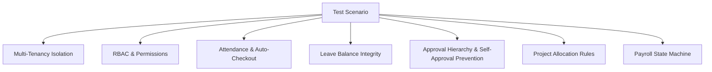

# Smarteam (EMS) — Complete System Context & QA Testing Guide

> **Document Purpose:** This document provides a comprehensive overview of the Smarteam Enterprise Workforce & HR Management System (EMS). It equips QA Engineers, testers, and developers with complete domain context, architecture details, feature breakdowns, role-permission matrices, and exhaustive testing checklists.

---

## 1. System Overview & Architecture

### 1.1 What is Smarteam?
**Smarteam** is an enterprise-grade Workforce Management (EMS) and Human Resource platform. It provides end-to-end automation for employee records, time & attendance tracking, shift scheduling, multi-project and multi-team allocations, leave policies, timesheets, multi-step approval workflows, document management, and payroll processing.

### 1.2 Tech Stack & Topology
- **Frontend Applications (Next.js App Router & Tailwind CSS):**
  - **Organization Workspace (`apps/web-org`)**: The primary web portal (`http://localhost:3000`) used by Employees, Managers, and Organization Administrators.
  - **Platform Admin Console (`apps/web-admin`)**: Platform superadmin portal (`http://localhost:3001`) for tenant provisioning and federation governance.
- **Backend API (`apps/api`):**
  - **NestJS** REST API (`http://localhost:4000`) with Swagger docs at `http://localhost:4000/docs`.
  - **Prisma ORM** over PostgreSQL with **hardened Row-Level Security (RLS)** session variables (`app.organization_id`) per transaction.
  - **Redis & BullMQ** for background job queues (auto-checkout, scheduled payroll, notifications).
  - **S3-compatible Object Storage** for secure document and avatar management.
- **Shared Packages:**
  - `@smarteam/contracts`: Shared TypeScript schemas, DTOs, permission keys, and federation contracts.
  - `@smarteam/ui`: Shared design system and component primitives.

### 1.3 Dual-Context Workspace Model
The frontend UI operates in two distinct context modes switchable based on user permissions:
1. **`EMPLOYEE` Context:**
   - **My Space**: Personal self-service hub (punches, attendance logs, leave balances, timesheets, personal projects, payslips).
   - **Team**: Assigned squad roster, direct report oversight for managers.
2. **`ADMIN` Context:**
   - **Organization**: Full administrative governance hub (employees, branches, RBAC roles, attendance logs, shift policies, leave types, payroll runs, company documents).

---

## 2. Test Environments, Accounts & Setup

### 2.1 Running the Applications Locally
```bash
# 1. Install dependencies
pnpm install

# 2. Configure environment variables (copy and fill .env)
cp .env.example .env

# 3. Generate Prisma client & run database migrations
pnpm run db:generate
pnpm run db:migrate

# 4. Start all applications in development mode
pnpm run dev
```

### 2.2 Seeding a Populated Test Tenant
To generate a fully functional tenant with employees, reporting lines, departments, branches, holidays, teams, and projects:
```bash
node scripts/seed-ui-tenant.mjs
```
*Note: This script outputs the test organization ID and writes the temporary administrator password to `.seed-credentials.local` (e.g. `admin@uicheck-xxx.test`).*

### 2.3 Built-in Persona Types for Testing

| Persona / Role | Intended Capabilities | Contexts Accessible |
| :--- | :--- | :--- |
| **Super Admin (Platform)** | Tenant provisioning, global audit, federation contracts | Web-Admin (`:3001`) |
| **Tenant Admin / HR Admin** | Full company setup, employee CRUD, RBAC roles, shift/leave policies, payroll runs | Admin (`Organization`) + My Space |
| **Reporting Manager / Team Lead** | Team roster oversight, approving reportees' leave, timesheets & punch corrections | Team + My Space |
| **Standard Employee** | Punch clock, apply for leave, submit weekly timesheets, view assigned projects/teams | My Space |

---

## 3. Complete Feature Breakdown & QA Test Guide

---

### Module 1: Authentication, Sessions & Multi-Tenancy

#### Key Capabilities:
- Native Email & Password authentication with CSRF protection (`x-csrf-token`).
- Multi-Organization tenant selector for accounts with multiple memberships.
- Forced password change on first sign-in (`passwordChangeRequired: true`).
- Biometric & WebAuthn / Passkey registration and assertion for punch verification.
- Session restoration via `GET /v1/auth/me` on browser reload.
- Token revocation and multi-device session invalidation.

#### What to Test (QA Checklist):
- [ ] **Valid Login:** Log in with correct email/password; verify token cookie and CSRF token exchange.
- [ ] **Invalid Login:** Attempt login with wrong password or non-existent email; ensure appropriate error messaging.
- [ ] **Mandatory Password Reset:** Sign in with a newly provisioned user where `passwordChangeRequired = true`. Verify the app forces password reset before any workspace access.
- [ ] **Multi-Org Switching:** Log in with a user belonging to multiple organizations; verify organization picker modal displays and switches tenant context properly.
- [ ] **Session Restoration:** Refresh browser on any sub-page; ensure session restores seamlessly without flashing the login screen.
- [ ] **Session Invalidation / Logout:** Click logout; verify cookies are purged and protected routes redirect to login.
- [ ] **Tenant Isolation (RLS):** Verify a user cannot view, query, or mutate resources belonging to another organization ID.

---

### Module 2: Employee Self-Service ("My Space")

#### 2.1 Screen 1 — Overview & Dashboard
- **Profile Presence Card:** Displays current login avatar, employee ID, job title, department, assigned branch, and current shift.
- **Punch Clock Widget:** Live digital clock, "Check In" / "Check Out" toggle buttons, real-time timer tracking elapsed work hours today.
- **Quick Action Bar:** Quick buttons for *Apply Leave*, *Log Time*, *View Payslips*, and *Download ID Card*.
- **Pending Tasks & Approvals:** Lists items needing action (e.g., draft timesheets, pending document acknowledgments).

#### 2.2 Screen 2 — Attendance Timeline
- **Visual Daily Timeline:** Chronological timeline showing all punch-in and punch-out events for the selected date.
- **Calculated Metrics:** First In, Last Out, Total Working Hours, Break Duration, and Overtime.
- **Punch Status Indicators:** Normal, Late In, Early Out, or Missing Checkout warning.

#### 2.3 Screen 3 — Attendance Table (Monthly/Weekly View)
- **Tabular Log:** Columns for Date, Shift, In Time, Out Time, Total Hours, Shift Status (Present, Half Day, Absent, On Leave, Holiday, Weekend).
- **Date Filtering & Navigation:** Previous/Next month selector, custom date range pickers.
- **Attendance Correction Request:** Triggering a correction request for missing punches or missed checkouts.

#### 2.4 Screen 4 — Attendance Calendar
- **Interactive Monthly Grid:** Color-coded days displaying attendance state (Green = Present, Red = Absent, Yellow = Half Day, Purple = Leave, Blue = Holiday, Gray = Weekend).
- **Day Details Drawer:** Clicking any calendar day opens a drawer with precise punch logs and shift rules for that day.

#### 2.5 Screen 5 & 6 — Time Tracker & Timesheets
- **Weekly Timesheet Grid:** Daily breakdown of logged hours mapped to assigned projects and tasks.
- **Manual Time Entry (Log Time Modal):** Input project, task description, date, start time, end time, or duration.
- **Timesheet State Lifecycle:**
  - `DRAFT`: Employee can freely add, edit, or delete entries.
  - `SUBMITTED`: Timesheet is locked against edits and sent to manager for approval.
  - `APPROVED` / `REJECTED`: Final locked states with approver comments.

#### 2.6 Screen 7 — Time Off / Leave Management
- **Leave Balance Cards:** Real-time balances for *Casual Leave (CL)*, *Sick Leave (SL)*, *Earned / Privilege Leave (EL)*, etc.
- **Apply Leave Drawer/Modal:**
  - Leave type selection, single day / half day (First Half / Second Half) / multi-day range.
  - Automatic calculation of deducted days (excluding public holidays and non-working weekends).
  - Reason field and optional medical certificate/document upload.
- **My Leave Requests Table:** Shows history of requested leaves, approval status badges (`PENDING`, `APPROVED`, `REJECTED`, `CANCELLED`), and cancellation button for pending requests.

#### 2.7 Employee Projects & Teams
- **My Projects:** Displays projects where the employee is an active member, displaying their specific Project Role (e.g. "Frontend Lead") and Allocation % (e.g. 50%).
- **My Teams:** Displays assigned squad/team, team lead name, and member count.

#### 2.8 Employee Payroll & Payslips
- **Payslips List:** Monthly issued payslip cards.
- **Payslip Detail Modal:** Complete breakdown of Basic Pay, HRA, Allowances, PF/ESI deductions, Professional Tax, Net Payable, and PDF download trigger.

---

### Module 3: Team Space & Manager Hierarchy

#### Key Capabilities:
- **Team Roster:** Squad members, roles, current day attendance status (In Office, Remote, On Leave).
- **Reporting Line Hierarchy:** Dynamically resolves direct reports via `Employee.managerEmployeeId`.
- **Approvals Inbox (`ScreenApprovals`):**
  - Multi-domain tabs: **Leave Requests**, **Timesheets**, **Attendance Corrections**.
  - Review request details, reason, attached documents, and conflicting team leave schedules.
  - **One-Click Actions:** *Approve* or *Reject with Comments*.
- **Strict Self-Approval Prevention:** Backend and UI strictly prohibit managers from approving their own leave or timesheets.

#### What to Test (QA Checklist):
- [ ] **Direct Report Visibility:** Log in as Manager MGR-001; verify only direct reportees appear in pending approvals.
- [ ] **Approve Leave:** Approve an employee's leave request; verify the employee's leave status updates to `APPROVED` and balance updates immediately.
- [ ] **Reject with Remarks:** Reject a timesheet with mandatory comment; verify employee receives rejection status and can edit/resubmit.
- [ ] **Anti-Self Approval:** Attempt to submit a leave request as a Manager; verify the manager cannot approve their own submission in the approvals tab.

---

### Module 4: Organization Administration ("Organization" Space)

#### 4.1 Organization Profile & Branches
- **Org Metadata:** Company name, legal entity, slug, default timezone (e.g. `Asia/Kolkata`), base currency (`INR`, `USD`).
- **Branch Management:** Multiple branch setup (e.g., HQ Mumbai, Tech Center Bengaluru), branch code, geofence radius, and default timezone per branch.

#### 4.2 Employee Onboarding & Directory
- **Onboarding Wizard (`ScreenOnboarding`):**
  - Step 1: Personal Info (First/Last name, work email, phone, DOB, gender).
  - Step 2: Employment Details (Employee ID, date of joining, employment type: Full-time/Contract/Intern, primary branch).
  - Step 3: Job & Department (Designation, Department, Manager selection).
  - Step 4: Compensation & Salary Structure (CTC, Basic, HRA, pay cycle).
  - Step 5: User Access Provisioning (Generate login credentials, assign initial RBAC roles).
- **Employee Directory & Drawer:** Filter by status (Active, Probation, Notice, Terminated), department, branch. Drawer allows editing profiles, changing managers, and viewing audit history.

#### 4.3 RBAC Roles & Permissions Governance
- **Custom Role Builder (`AccessCreateRoleDialog`):** Create roles with custom names and select fine-grained permissions (`employees.write`, `leave.types.write`, `payroll.runs.approve`, etc.).
- **User Role Assignments (`AccessManageDrawer`):** Assign multiple roles to a user, with optional branch-level scoping and validity date ranges (`startsAt`, `endsAt`).

#### 4.4 Shifts & Scheduling (`ScreenShifts`)
- **Shift Definitions:** Shift name, start time, end time, grace check-in minutes, half-day threshold hours, full-day threshold hours.
- **Roster & Assignments:** Assign individual employees or whole departments to specific shifts with effective date ranges.

#### 4.5 Holidays Management (`ScreenHolidays`)
- **Holiday Calendar:** Add national and regional holidays with date, name, and optional branch-specific restrictions.
- **Holiday Attendance Impact:** System automatically flags punches on holidays as Overtime/Holiday Work and ignores holidays when calculating leave deductions.

#### 4.6 Leave Policy Configuration (`ScreenLeaveAdmin`)
- **Leave Types:** Create and configure leave policies (Annual Accrual count, Max carry-forward limit, Encashment eligibility, Gender restriction, Probation waiting period).
- **Balance Adjustments:** Admin ability to credit/debit leave days manually with audit justification.

#### 4.7 Timesheets Administration (`ScreenTimesheetsAdmin`)
- **Timesheet Periods:** Generate weekly/bi-weekly timesheet cycles.
- **Organization Timesheet Monitor:** View submission compliance across departments (% submitted, % approved, % missing).

#### 4.8 Teams & Projects Management (`ScreenTeams`, `ScreenProjects`)
- **Multi-Team Support:** Create teams, assign Team Leads, and add multiple members (many-to-many relationship).
- **Multi-Project Support:** Create projects with project codes, client name, start/end dates.
- **Project Allocation Enforcement:** Assign members with specific project roles and allocation percentage (e.g., 50%). Validates total allocation across projects does not exceed 100% and prevents overlapping date ranges.

#### 4.9 Payroll Processing Engine (`ScreenPayrollAdmin`)
- **Payroll Runs:** Create monthly payroll batch runs (`DRAFT` $\rightarrow$ `PROCESSING` $\rightarrow$ `APPROVED` $\rightarrow$ `DISBURSED`).
- **Calculation Rules:** Computes Payable Days = (Total Days - Unpaid Leaves - Unauthorized Absences), calculates Gross Earnings, PF/ESI/Tax deductions, and Net Pay.
- **Staleness Protection:** Prevents finalizing payroll if attendance or leave records were modified after run calculation.
- **Payslip Generation:** Bulk generates and publishes payslips to employee self-service.

#### 4.10 Document & File Management (`ScreenFiles`)
- **Document Categories:** Personal KYC, Contracts, Offer Letters, Company Policies.
- **Access Control:** Restricted access tags (Employee only, HR Admin only, Public).

---

## 4. Priority Test Scenarios & Edge Cases



### Scenario 1: Multi-Tenancy & Data Isolation
1. Authenticate as Admin of Tenant A.
2. Attempt to read or edit an employee ID from Tenant B via API or modified request.
3. **Expected Result:** Postgres RLS and service context reject the request with `404 Not Found` or `403 Forbidden`. No cross-tenant data leaks.

### Scenario 2: Granular RBAC Permissions
1. Assign a user a role with ONLY `leave.requests.read` and `leave.requests.write`.
2. Attempt to access `/v1/organizations/:id/payroll` or open the Payroll admin screen.
3. **Expected Result:** UI hides the Payroll tab; direct API calls return `403 Forbidden`.

### Scenario 3: Punch Lifecycle & Missing Checkout
1. Employee punches in at 09:00 AM but forgets to punch out.
2. On next day, verify system flags the record as `MISSING_CHECKOUT`.
3. Submit an Attendance Correction request with revised out-time (06:00 PM).
4. Verify Manager sees the correction request in Approvals, approves it, and the daily hours update to 9 hours.

### Scenario 4: Leave Balance Deductions & Weekends/Holidays
1. Request 4 days of leave from Friday to Monday. Saturday and Sunday are marked as non-working days; Monday is a configured Public Holiday.
2. **Expected Result:** System correctly deducts only **1 day** (Friday) from the leave balance.

### Scenario 5: Timesheet Locking After Submission
1. Employee logs 40 hours for Week 38 and clicks *Submit Timesheet*.
2. Status transitions from `DRAFT` to `SUBMITTED`.
3. Verify the employee can no longer edit, delete, or add entries to that week's timesheet while under review.

### Scenario 6: Multi-Project Allocation Cap
1. Assign Employee A to Project Alpha at 60% allocation.
2. Assign Employee A to Project Beta at 40% allocation.
3. Attempt to assign Employee A to Project Gamma at 20% allocation for the same period.
4. **Expected Result:** System warns/rejects because total allocation exceeds 100%.

### Scenario 7: Payroll Processing Staleness Check
1. Admin creates a Draft Payroll Run for August 2026.
2. Employee submits a backdated leave adjustment for August, which is approved.
3. Admin attempts to approve the payroll run.
4. **Expected Result:** System flags the payroll calculation as stale, requiring a re-calculation before final disbursement.

---

## 5. Automated Verification Test Suite

The repository contains pre-built verification scripts located in `scripts/`. Testers can execute these scripts against a running API instance:

| Script Command | Target Feature / Verification Area |
| :--- | :--- |
| `node scripts/verify-auth.mjs` | Native authentication, CSRF, JWT validation, platform login |
| `node scripts/verify-authorization-boundaries.mjs` | Tenant isolation, cross-tenant IDOR prevention |
| `node scripts/verify-role-permissions.mjs` | RBAC permission matrix and dynamic role changes |
| `node scripts/verify-employees.mjs` | Employee CRUD, branch links, employment records |
| `node scripts/verify-attendance.mjs` | Punch in/out, shift calculation, attendance logs |
| `node scripts/verify-auto-checkout.mjs` | Midnight auto-checkout and missing punch detection |
| `node scripts/verify-leave.mjs` | Leave accruals, deductions, balance limits, carryovers |
| `node scripts/verify-ownership-and-approvals.mjs` | Multi-step approval workflows & anti-self-approval |
| `node scripts/verify-timesheet-approval-cycle.mjs` | Timesheet submission, review, approval & edit locking |
| `node scripts/verify-teams-projects.mjs` | Multi-team, multi-project & allocation percentage rules |
| `node scripts/verify-payroll.mjs` | Payroll salary components, calculations, runs & payslips |
| `node scripts/verify-payroll-staleness.mjs` | Staleness detection when attendance/leave changes |
| `node scripts/verify-files.mjs` | Document uploads, S3 storage, category permissions |

---

## 6. QA Defect Reporting Standard

When logging defects for Smarteam, include the following parameters:
1. **Tenant Organization ID & Slug** (e.g. `uicheck-xxx` / `9ac56bd4-...`).
2. **User Persona / Account** (e.g. `Admin`, `Manager MGR-001`, `Employee EMP-102`).
3. **Workspace Context** (`EMPLOYEE` -> My Space/Team or `ADMIN` -> Organization).
4. **Exact Steps to Reproduce**.
5. **Expected vs Actual Behavior**.
6. **Network Request / Response Payload** (status code, endpoint, response JSON).
7. **Browser Console Output & Screenshots/Recordings**.
